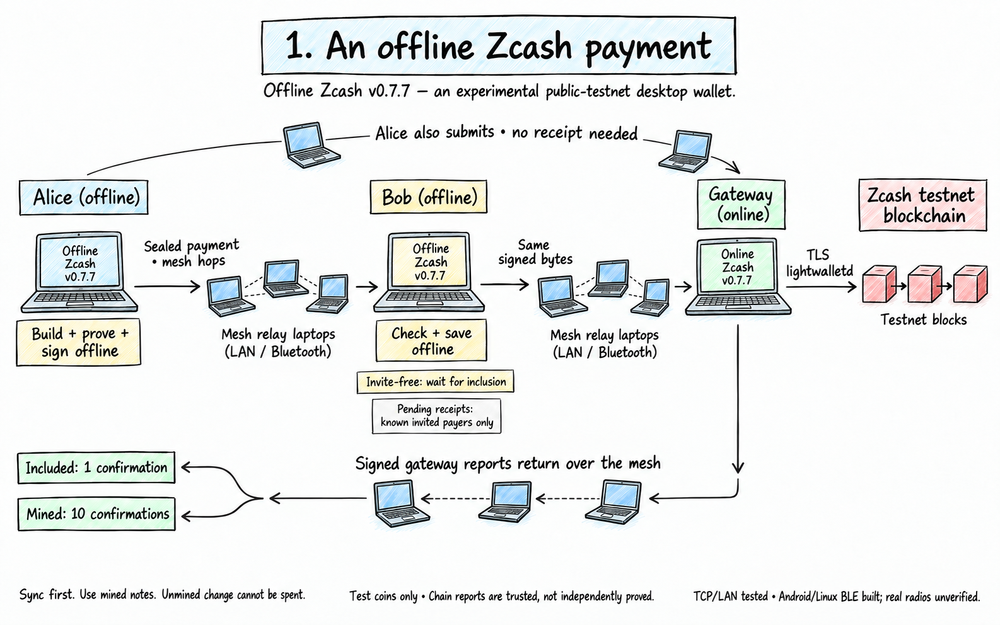

# Offline Zcash

Pay with Zcash when there is no internet. Your device builds, proves and signs a shielded payment on its own, then passes it from device to device over a local mesh until it reaches the person you're paying. They check it offline and send back a signed receipt. As soon as any device on the mesh has internet, it puts the payment on chain, and everyone sees it confirmed.



More diagrams, inside the mesh and at the gateway: [docs/how-it-works.md](docs/how-it-works.md).

It runs in [Logos Basecamp](https://docs.logos.co/basecamp) or as a command-line node, and both kinds of device can be in the same session. Basecamp has three apps: **Offline Zcash** (wallet/pay/mesh), **Organiser** (sessions and invites) and **Gateway** (chain RPC and submissions). Install any combination; they share one service, identity, wallet and mesh per device. The operator's `ths start` Docker chain stays outside Basecamp.

**Status:** experimental v0.7.2, for NU7 public testnet (TAZ) and the local Regtest harness, never real ZEC. The gateway uses configurable TLS lightwalletd, not a full node. Chain state and inclusion are explicitly gateway-reported, not independently proved. Funded public split/payment testing is blocked by faucet failures; see [testnet setup and limits](docs/install.md#public-testnet-v070). It has not been security reviewed.

## Try it

- **[Install by name in Basecamp](docs/basecamp-install.md#install-by-name-recommended):** add the public catalogue in Settings → Package Repositories, search `zcash` in Manage Packages, and install the service and apps. No GitHub token needed.
- **[Use the command-line node](docs/install.md):** install `ozm-node`, then `ozm-node start`; it creates local keys and finds a gateway without an invite. Invite join remains optional.
- **[Try the Android test APK](docs/android-install.md):** Android 10+ arm64, native BLE + LAN, open or invited join, address payments and Max. No real-phone/radio validation yet.
- **[Run a three-laptop Basecamp session](docs/basecamp-install.md#a-three-mac-session-without-an-ozm-node-terminal):** create invites in Organiser and start Gateway in Basecamp. CLI sessions remain [supported](docs/mvp-v0.2.0.md#running-a-session).

Catalogue URL (also accepted by `logosctl catalog add`):

```text copy Copy Catalogue URL
https://raw.githubusercontent.com/megabyte0x/offline-zcash/main/logos-repo.json
```

With a running released `logosctl` daemon, add that URL, run `logosctl catalog
refresh`, then `logosctl package install zcash_offline_ui --yes` (it installs the
shared service too). [Full CLI commands](logos/README.md#install-by-name).
Packages are unsigned; install only if you trust this test build.

Manual `.lgx` downloads remain a [fallback](docs/basecamp-install.md#manual-lgx-fallback)
on the [releases page](https://github.com/megabyte0x/offline-zcash/releases/latest).

v0.7.2 ships **four merged catalogue packages and four `.lgx` packages per platform** (service + three apps), CLI tarballs and the Android APK. See [CHANGELOG.md](CHANGELOG.md) for release notes. The owner tested v0.5.1 successfully on three real Macs; v0.7.2 has not been tested there. Basecamp Local Network permission support is pending [upstream #527](https://github.com/logos-co/logos-basecamp/issues/527). Dial `<operator-ip>:7777` if discovery fails.

Paste a unified address for the fleet's network with an Ironwood receiver; exchange addresses
outside the app. Max quotes the builder's actual ZIP 317 action fee. A destination
not on the mesh still gets submitted, with **no payee receipt**. Open devices select
the nearest signed gateway (hops, then highest advertised tip), pin its key on first
use, and block silent changes. Address bindings prove receiving authority and are
pinned when first used. Open/unknown payers are not accepted pending. **Sync,
inclusion and mined results are gateway-reported**, not independently verified
chain proofs. First contact does not authenticate an operator. Use a trusted local
operator and test coins only. [Trust model and limits](docs/basecamp-install.md#open-mode-trust-and-faucet-limits).

## For developers

| Path | What |
|---|---|
| [crates/zcash-offline-core](crates/zcash-offline-core) | Wallet sync, offline builder, payee checks, sealed envelopes, signed messages |
| [crates/ozm-mesh](crates/ozm-mesh/README.md) | BitChat-style mesh: TTL flooding, BLE-sized frames, store-and-forward, acks, LAN discovery |
| [crates/ozm-node](crates/ozm-node) | The device: roles, payment store, gateway, HTTP API and web UI |
| [logos](logos/README.md) | One Basecamp core module and three thin QML apps |
| [android](docs/android-install.md) | Android test shell, BLE byte link, UniFFI/Kotlin build and JVM payment check |
| [bench](bench/README.md) | Multi-container tests: `bench/mesh-bench.sh all` (multi-hop), `bench/lan-bench.sh all` (invites), `bench/open-bench.sh all` (six devices, no invites) |
| [docs](docs/README.md) | Design, components, results per version ([v0.1.0](docs/mvp-v0.1.0.md), [v0.2.0](docs/mvp-v0.2.0.md)) |
