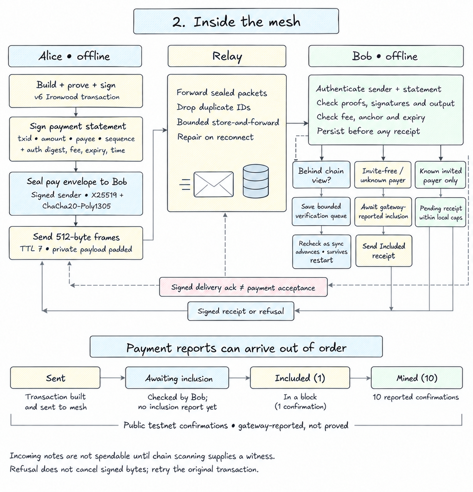
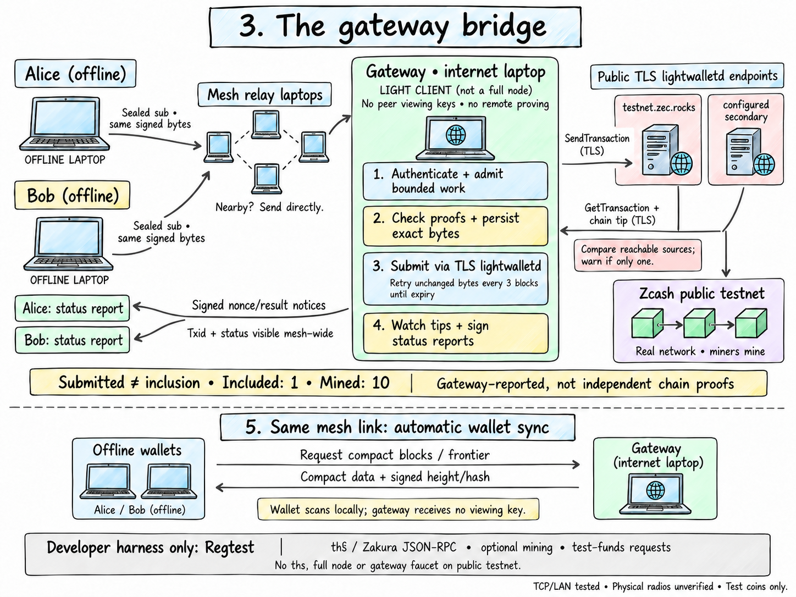

# How it works

Alice can send Bob a shielded Zcash payment without either laptop having internet.
Her device builds, proves and signs it locally. Nearby devices carry the signed
bytes to Bob and to a gateway, which submits them and reports the result back.

This page describes **v0.7.7 on public testnet**, not the future mainnet design.
TCP/LAN is tested; Android and Linux BLE links are implemented but physical
radios remain unverified. Use test coins only.

## Before going offline

Start a wallet without an invite and let it find a trusted gateway. It creates
its own keys and receive address, chooses a scan start and syncs automatically.
Fund it with TAZ while connected. The wallet automatically splits sufficiently
large mined funding into smaller notes when economical. Wait for the split's
gateway-reported mining and a scan that makes the notes spendable.

**Offline payments consume previously synced, mined notes.** Change and new
incoming funds cannot be spent without scanning their inclusion and obtaining
witnesses. More prepared notes allow more independent offline payments; this
does not enable chains of unmined payments.

## 1. The payment journey

1. **Alice builds and proves** a v6 Ironwood transaction from her spendable notes.
   Reservations and signed bytes are persisted before sending.
2. **The mesh carries a sealed payment to Bob**, directly or through relays,
   with a default TTL of seven links. Every device relays; that is not a role
   users have to select. Bounded caches carry packets through disconnections.
3. **Bob authenticates and checks the payment**, then saves it. If his chain
   view is behind, a bounded durable queue keeps it for rechecking as sync
   advances, even after restart or the sender disappearing from discovery.
4. **Both Alice and Bob submit the same signed bytes to the gateway.** Alice
   does not wait for a payee receipt. If the destination address has no mesh
   binding, the payment still submits, explicitly with **no payee receipt**.
5. **The gateway submits through TLS lightwalletd.** It needs no full node or
   peer viewing keys. Public-testnet miners, not the gateway, mine the payment.
6. **Signed reports return over the mesh.** `included` means one reported
   confirmation and `mined` means ten. Neither is independent proof or finality.
   Bob's wallet syncs to discover the mined note and make it spendable.

**A delivery ack is not acceptance.** In the default invite-free mode Bob waits
for gateway-reported inclusion before sending an Included receipt. Only known
invited payers can get an earlier pending receipt, subject to local test-coin
caps. Pending acceptance does not prevent a double-spend.

## 2. Inside the mesh

Private messages use signed `ozm1` envelopes sealed to the recipient with X25519
and ChaCha20-Poly1305, fragmented into 512-byte mesh frames. Payment, submission
and receipt padding uses 4 KiB multiples; sync/control uses smaller buckets.
Relays cannot read private amounts or statements, but **sender/recipient mesh
IDs, sizes and timing remain visible**. Signed gateway nonce/result notices
deliberately expose txid and status mesh-wide.

| Event | What it establishes |
|---|---|
| Delivery ack | The destination mesh received this sealed payload; no payment acceptance |
| Waiting for chain view | Bob saved the envelope for later checks, not a receipt or refund |
| Awaiting inclusion | Checks passed, but an open/unknown payer is not accepted pending |
| Pending receipt | A known invited payer passed Bob's local checks and admission limits; still an IOU |
| Submitted / in mempool / retrying | Gateway submission progress, not inclusion |
| Included / Mined | Gateway-reported public-testnet confirmations: 1 / 10 |
| Scanned credit | Local scanning found an output; no invented sender, receipt or ten-confirmation report |

Acks, receipts and results can race, so states may be skipped. **Refusal does not
cancel signed bytes:** Alice's independent submission may still mine. Retry the
original transaction, rather than paying again from other notes. Only a local
scan past inclusive expiry can release unspent reservations; an expiry report
alone cannot. The scan itself still depends on trusted chain data.

## 3. The gateway bridge

The organiser exports one gateway invite; everyone else starts without an
invite. Installing the Gateway app does not grant the role. All three Basecamp
apps share one engine, wallet and mesh on each device.

- **Submission:** authenticate, apply finite admission limits, verify proofs and
  signatures, persist the exact bytes and submit to connected configured TLS
  servers. Reconcile and retry unchanged bytes every three blocks until expiry.
- **Responsiveness:** v0.7.7 bounds each chain check to 60 seconds, connection
  setup to 15 seconds per server, and submission processing to 90 seconds.
  Mesh submissions can wait up to 90 seconds for a running check; duplicate
  in-flight submissions share the result. Gateway-owned sends retain their
  bytes for retry if busy. These are timeouts, not delivery guarantees.
- **Sync:** serve compact blocks and frontiers. Each wallet scans locally;
  reachable secondary tree states cross-check batch-end roots. Tips push on
  every observed new height/hash, with a five-second gateway poll. Source
  agreement is consistency checking, not independent chain verification.
- **Trust:** invite-free wallets rank signed gateways by hops, then advertised
  tip, and pin the first used key. Check its mesh ID with the operator. Pins
  block silent replacement, not a dishonest first gateway or false chain data.
- **Regtest only:** `ths`/Zakura JSON-RPC, optional gateway mining and bounded
  test-funds requests. Public testnet has no gateway faucet, mining toggle or
  `ths` dependency.

The watcher stops polling transactions once reported `mined` to avoid blocking
new submissions. Do not treat that saved report as continuous reorg monitoring.
Independent PoW, MMR anchor paths and transaction-inclusion proofs remain unbuilt.

[Install and try it](basecamp-install.md) · [Architecture and planned mainnet controls](design.md)
· [Trust model](privacy-and-threats.md#trust-assumptions-at-v070)
· [Dated verification](open-work.md#built)
